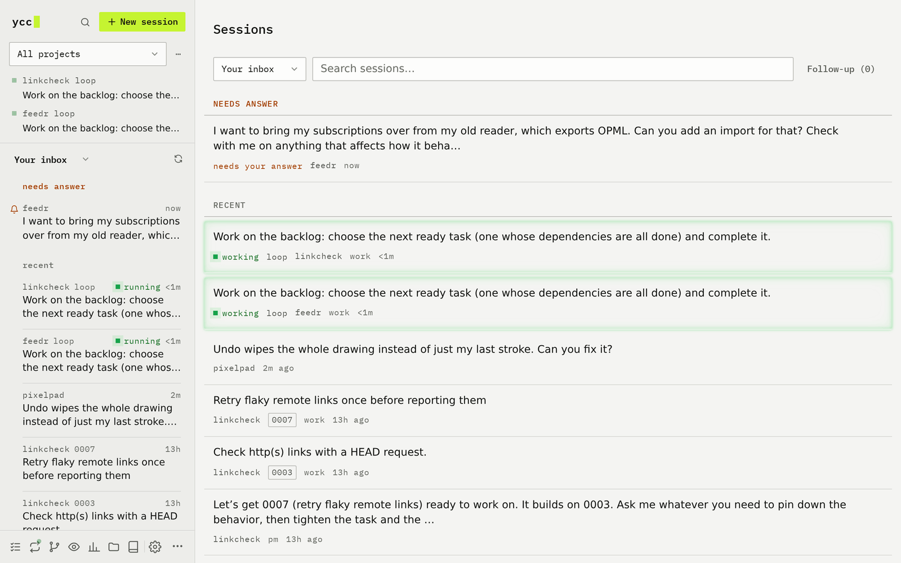
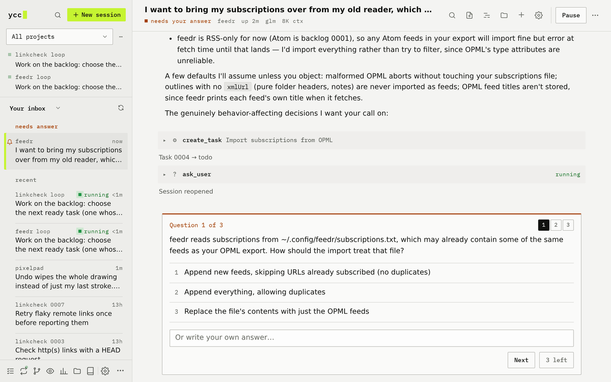
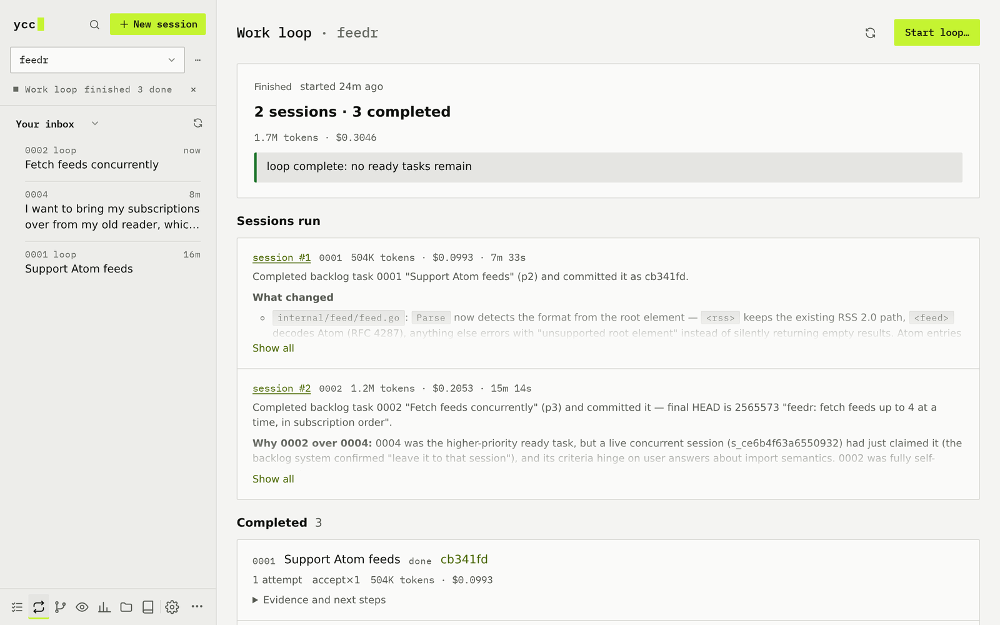
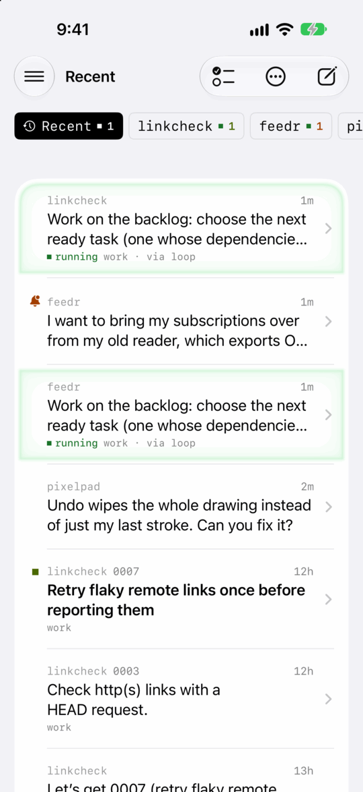
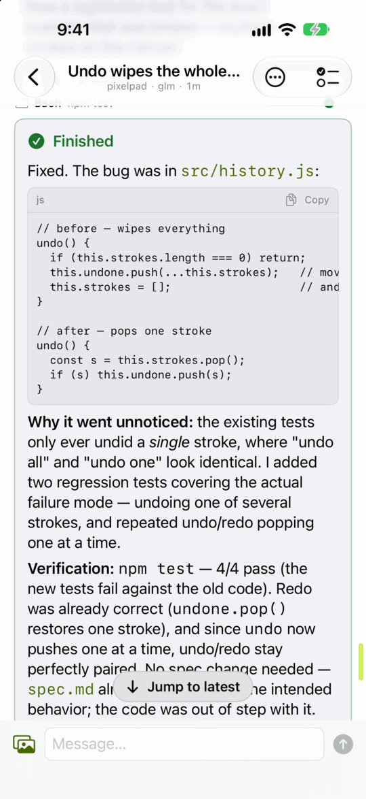
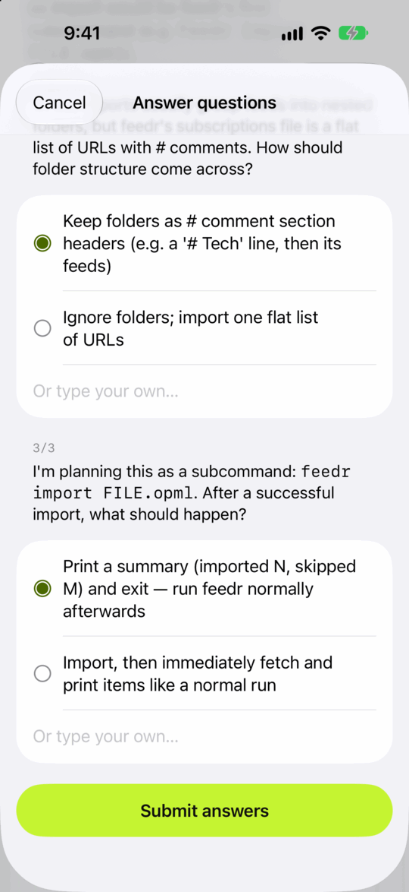

# ycc

`ycc` is a self-hosted coding agent daemon for your git repositories. Run one background process on your machine (or a home server) and work with agents across all your projects from a web UI, the CLI, or an optional iOS app. Sessions keep running when you close your browser or lock your phone.

What makes it different from running a CLI agent in a terminal tab:

- **One inbox across all your repos.** See what's running, what finished, and what's waiting on an answer from one place.
- **Mix models and providers.** Use Claude to write code and GPT to review it (or Gemini, Ollama, or any OpenAI-compatible endpoint), using existing subscriptions via `ycc login` or standard API keys.
- **Project state lives in git.** Tasks (`backlog/`), design docs (`spec.md`), and project gotchas (`memory.md`) are plain Markdown files committed alongside your code, so each session starts with fresh context instead of degrading over a 100-turn chat.
- **Interactive or hands-off.** Use normal chat for bug fixes and exploration, run a single backlog task with automated cross-model review, or start a work loop to chew through ready tasks unattended.



## Quickstart (local)

`ycc` is a single Go binary containing the daemon, CLI, and embedded web app. You don't need a remote server, Tailscale, or the phone app to try it.

```sh
go install github.com/whyrusleeping/ycc/cmd/ycc@latest   # or: go build -o ycc ./cmd/ycc

# Connect at least one provider (opens a browser login and updates ycc.toml)
ycc login anthropic    # Claude Pro/Max
# or: ycc login openai # ChatGPT Plus/Pro
# or use an API key: ycc token set ANTHROPIC_API_KEY

cd ~/code/myproject
ycc daemon --web
```

Starting `ycc daemon --web` inside a git repo registers that repo automatically, creates a local access token under `~/.local/state/ycc/daemon-token`, and prints the URL (`http://127.0.0.1:8787/`) along with the token path. Open the URL in your browser and paste the token once. If you skipped `ycc login`, the web app's **Get started** screen walks through connecting an account and adding projects.

If you prefer the terminal, CLI commands attach to the running local daemon automatically (using the same local token):

```sh
ycc start --mode chat "why is TestFoo flaky?"
ycc list
ycc attach <session-id>
```

Run `ycc doctor` at any time to check your setup and credentials.

## How a typical workflow looks

You don't need to rewrite your docs or adopt every feature up front. Most people start with chat on an existing repo and pull in the backlog and work loops as tasks pile up.

### 1. Start in chat

Open a **Chat** session in a project whenever something comes up: report a bug, paste a screenshot, ask how a subsystem works, or ask for a small change. The agent has full file and shell access, investigates, runs tests, and commits its changes when done.

You can send follow-up messages while an agent is working (delivered at the next safe step), pause it with **Interrupt** to steer it, or reopen any finished session later to continue the thread.

### 2. Answer questions when you have a minute

When a request leaves design or behavior decisions open, the agent pauses with multiple-choice questions and shows up at the top of your inbox. Pick an option (or type your own answer) from the web app or your phone, and it picks right back up.

### 3. Break bigger work into the backlog

For anything larger than a quick fix, talk through what you want in chat (or in **Project manager** mode, which edits `spec.md` and `backlog/` without touching code; its **Onboard** preset is handy for setting up a new repo or documenting just the part of an existing codebase you plan to change).

The agent writes Markdown task files in `backlog/` with acceptance criteria and dependencies, and updates `spec.md` if behavior is changing. Tasks you ask for start as `todo`; adjacent ideas an agent notices on its own start as `proposed` and won't run unless you promote them.

### 4. Run tasks one at a time, or in a work loop

From the **Backlog** view, you have two ways to execute tasks:

- **Single task (`Start work`).** Open a task and kick off a dedicated `work` session for just that item. The agent reads the task and relevant spec sections in a fresh session, implements it, runs a review pass (typically with a second model), updates the task file, and commits.
- **Work loop.** Start a loop on a project to run ready `todo` tasks back to back until the queue is empty. Work loops run unattended: if a task hits something that genuinely needs a human call, the agent marks it `blocked` with a reason and moves on instead of waiting forever.

<table>
<tr>
<td width="50%" valign="top"><br>Agents pause with structured questions instead of guessing; answer from the keyboard or mobile.</td>
<td width="50%" valign="top"><br>A finished work loop: each task got its own fresh session, review pass, and commit.</td>
</tr>
</table>

### 5. Check in from your phone (optional)

If you run the daemon on an always-on machine, the web app works well at a desk while the iOS app is great for quick check-ins away from your keyboard: scanning the inbox across projects, answering queued questions, kicking off a backlog task, or starting a chat when you spot a bug. Commit diffs are also clickable right inside any transcript when you want to inspect what landed.

<table>
<tr>
<td width="33%" valign="top"><br>Unified inbox across projects: running loops, sessions waiting on an answer, and unread completions.</td>
<td width="33%" valign="top"><br>Describe a bug in a chat; the agent diagnoses it, fixes it, and runs tests.</td>
<td width="33%" valign="top"><br>Unblock agents on the go by tapping answers to queued questions.</td>
</tr>
</table>

## What ycc puts in your repo (and safety notes)

### Repo files

State that agents and humans both edit is kept as plain committed files:

| Path | Purpose |
|---|---|
| `spec.md` (and optional `docs/`) | Current system design, interfaces, and invariants. `ycc spec-check` catches dead paths/symbols referenced in docs. |
| `backlog/NNNN-*.md` | One file per task: description, acceptance criteria, status, dependencies, and work log. |
| `memory.md` | Short operational notes and repo gotchas agents accumulate over time. |
| `.ycc/config.toml` | Optional per-repo settings (e.g. extra design doc globs, chat commit behavior). |

Session event logs and runtime state live under `.ycc/` and should stay untracked (add `.ycc/*` and `!.ycc/config.toml` to `.gitignore`).

### Git behavior

- In **Chat** mode, once verified work is finished, the agent commits only the files that session changed without asking first. To make it ask before committing, or to push automatically, set `finished_work` in `.ycc/config.toml`:
  ```toml
  [chat]
  finished_work = "ask"   # "commit" (default), "ask", or "commit+push"
  ```
- In **Work** mode (single tasks and work loops), each completed task is reviewed and committed on the current branch.

### Trust model and credentials

- **No container sandbox.** Agent shell tools run as your OS user on the daemon's machine and can read/write whatever that user can access. Run the daemon inside a VM or dedicated user account if you want isolation.
- **Subscriptions:** `ycc login anthropic|openai|google` stores OAuth tokens on the daemon host and refreshes them automatically. You can track subscription usage/quotas in the **Usage** view. Note that `ycc login google` is unofficial (it reuses the Antigravity CLI's OAuth client, which Google's terms prohibit for third-party tools and can result in account suspension); a standard `GEMINI_API_KEY` is the supported way to use Gemini.
- **API keys:** `ycc token set NAME` stores keys in the machine-local secrets store, and configs reference them by name (`key_env = "NAME"`). Known credential env vars are stripped from agent shells, though that is defense in depth rather than a sandbox.
- **Web search:** the `web_search` and `fetch_page` tools use [Exa](https://exa.ai) when `EXA_API_KEY` is set.
- **Don't paste secrets into prompts or answers.** Session logs are persisted model history. `ycc` rejects obviously credential-shaped input, but if a secret makes it into a session, rotate it at the provider.

## Running an always-on daemon & connecting clients

To keep work running across projects on a home Linux box or VM, run `ycc daemon --web` under tmux, screen, or systemd and bind it to a private network address (such as Tailscale or WireGuard):

```sh
export YCC_TOKEN=$(openssl rand -hex 32)
ycc daemon --web --addr 100.64.0.1:8787
```

The daemon refuses to bind a non-loopback address without a token. Treat `YCC_TOKEN` like an SSH key: anyone with it can run shell commands in your registered repos. If a device isn't on your tailnet/VPN, put a TLS-terminating reverse proxy or tunnel in front of the daemon, or pass `--tls-cert` and `--tls-key`.

Add more repositories anytime from the web or iOS UI (**Add project…**) or via the CLI:

```sh
ycc project add ~/code/another-project
```

### Building the iOS app

There is no App Store release; build [`clients/ios`](clients/ios) onto your own device with Xcode:

```sh
cd clients/ios && xcodegen generate
```

Open `Ycc.xcodeproj` in Xcode, pick your signing team, and install it on your phone. On first launch, enter your daemon URL and `YCC_TOKEN` (stored in Keychain).

## Configuration

`ycc` loads the first config file it finds: `./ycc.toml` in the workspace, `~/.config/ycc/ycc.toml`, or `--config <path>`. `ycc login` writes model entries automatically, and most settings can also be edited from the web or iOS **Settings** screen.

A typical multi-model setup (one model coding, another reviewing, and both reviewing high-risk changes in parallel):

```toml
[models.opus]                      # logical name of your choice
backend = "anthropic"
model   = "claude-opus-5-5"
auth    = "oauth"                  # from `ycc login anthropic`

[models.sol]
backend = "openai"
model   = "gpt-6.1-sol"
auth    = "oauth"                  # from `ycc login openai`

[roles]
coordinator = "opus"               # runs sessions, writes code, commits
implementer = "sol"                # optional subagent model for delegated coding
reviewers   = ["sol"]

[reviews.tiers.standard]           # ordinary changes: one reviewer
models = ["sol"]

[[reviews.tiers.comprehensive.reviewers]]   # risky or large changes: parallel review
model = "opus"
[[reviews.tiers.comprehensive.reviewers]]
model  = "sol"
prompt = "Focus on correctness and code cleanliness."
```

Other supported backends are `gemini` (native Gemini API), `openai-compatible` (with `base_url` and `key_env`), and `ollama`. For example, Gemini with an API key:

```toml
[models.neon]
backend = "gemini"
model   = "gemini-4-neon"
key_env = "GEMINI_API_KEY"
```

Optional `[budget]` caps (`session_cost`, `loop_cost`) stop sessions or loops at a spend/token limit. See [`spec.md` §13](spec.md#13-models-credentials-and-review-tiers) for the full schema.

For repositories whose design docs span multiple files, list them in `.ycc/config.toml`:

```toml
spec_path = "spec.md"
doc_globs = ["docs/*.md", "docs/design/*.md"]
```

### Optional: publishing files (`ycc-share`)

The file viewer in the web and iOS apps can publish Markdown, text, images, PDFs, or sandboxed HTML to an unguessable expiring URL via [`ycc-share`](docs/design/publishing.md), a small companion server you host behind TLS:

```sh
go install github.com/whyrusleeping/ycc/cmd/ycc-share@latest
ycc-share --data /var/lib/ycc-share --public-url https://paste.example.com \
  --token-file /etc/ycc-share/token
```

Store the upload token on the daemon host with `ycc token set YCC_PUBLISH_TOKEN` and add a `[publish]` block to `ycc.toml`:

```toml
[publish]
url       = "https://paste.example.com"
name      = "paste.example.com"
token_env = "YCC_PUBLISH_TOKEN"
```

## Docs & references

- [`docs/cli.md`](docs/cli.md) — full CLI command reference (`ycc start`, `ycc task`, `ycc export`, `ycc analytics`, etc.)
- [`docs/remote-api.md`](docs/remote-api.md) — Connect RPC HTTP API for writing custom clients
- [`spec.md`](spec.md) and [`docs/design/`](docs/design/) — full architecture and design notes
- [`CONTRIBUTING.md`](CONTRIBUTING.md) — change, testing, and review guidelines

## Development

This repository uses `ycc`'s own layout (`spec.md`, `backlog/`, `plans/`, `memory.md`, `CONTRIBUTING.md`).

| Path | Contents |
|---|---|
| `cmd/ycc` | Binary entrypoint: CLI commands and daemon startup |
| `internal/` | Engine (agent loop), orchestrator (modes, work/review flow), Connect RPC server, session/event logs, tools, providers, workstreams, embedded web bundle |
| `proto/ycc/v1` | `ycc.proto`, the shared wire schema |
| `clients/web` | Web app (TypeScript, React, Vite); built bundle committed to `internal/web/dist` |
| `clients/ios` | iOS app (SwiftUI + `YccKit` Swift package) |

CI runs Go 1.26.10 on Linux and Xcode 16.4 on macOS. Run the matching local checks before submitting changes (no provider API keys needed; Swift checks require macOS):

```sh
# Go: formatting, vet, tests (uncached), end-to-end tests, race detector, docs drift
test -z "$(git ls-files '*.go' | xargs gofmt -l)"
go vet ./...
go test -count=1 ./...
go test -count=1 -v ./internal/e2e   # every TestE2E test must PASS, not SKIP
go test -race -count=1 ./...
go run ./cmd/ycc spec-check

# Vulnerability scan (depends on Go patch version)
go install golang.org/x/vuln/cmd/govulncheck@v1.8.0 && govulncheck ./...

# Web client: install from lockfile, typecheck, bundle, Vitest; committed bundle must match
scripts/web-build.sh
git diff --exit-code -- internal/web/dist

# iOS (macOS only, XcodeGen 2.44.1)
swift test --package-path clients/ios/YccKit
(cd clients/ios && xcodegen generate)
xcodebuild -project clients/ios/Ycc.xcodeproj -scheme Ycc \
  -destination 'generic/platform=iOS Simulator' CODE_SIGNING_ALLOWED=NO build
```

If you modify `proto/ycc/v1/ycc.proto`, regenerate the Go, Swift, and TypeScript bindings together per [`plans/build-and-test.md`](plans/build-and-test.md) (CI checks with buf v1.71.0, protoc-gen-go v1.36.11, and protoc-gen-connect-go v1.20.0).
