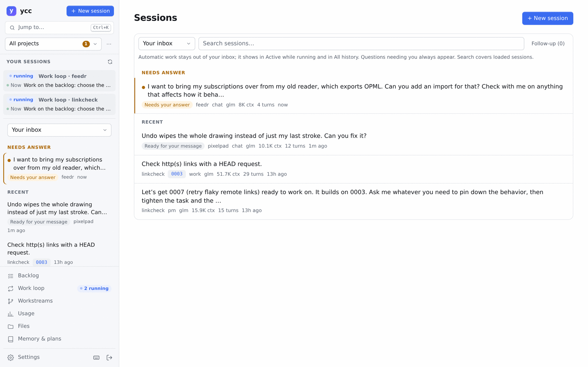
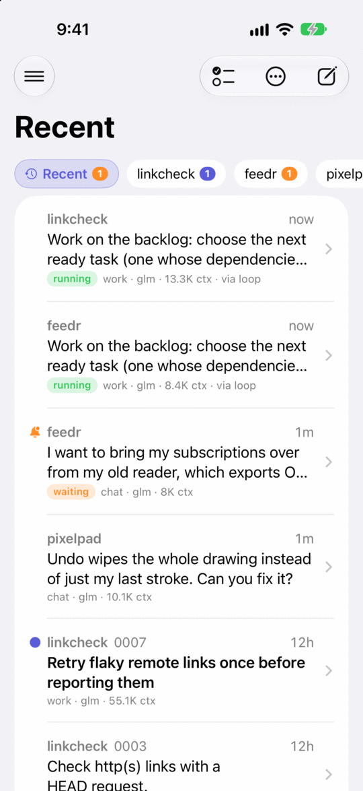
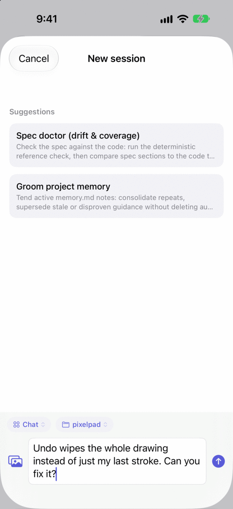
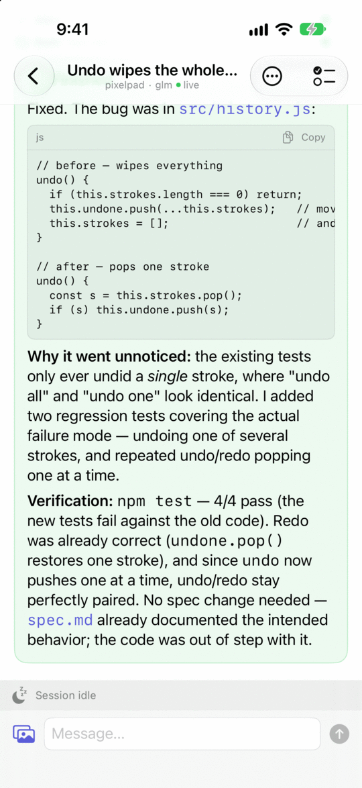
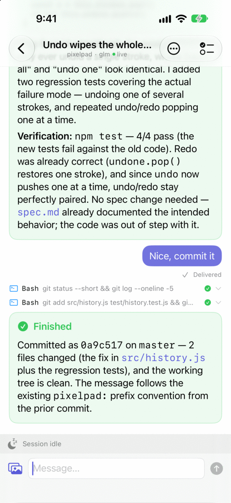
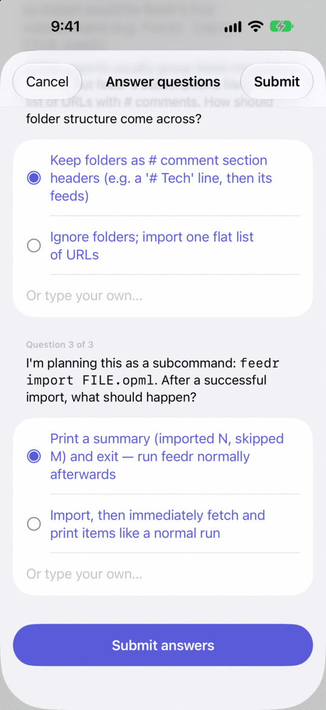
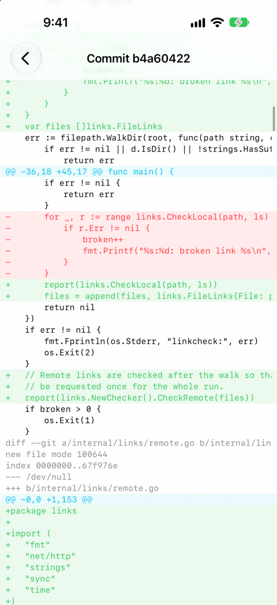
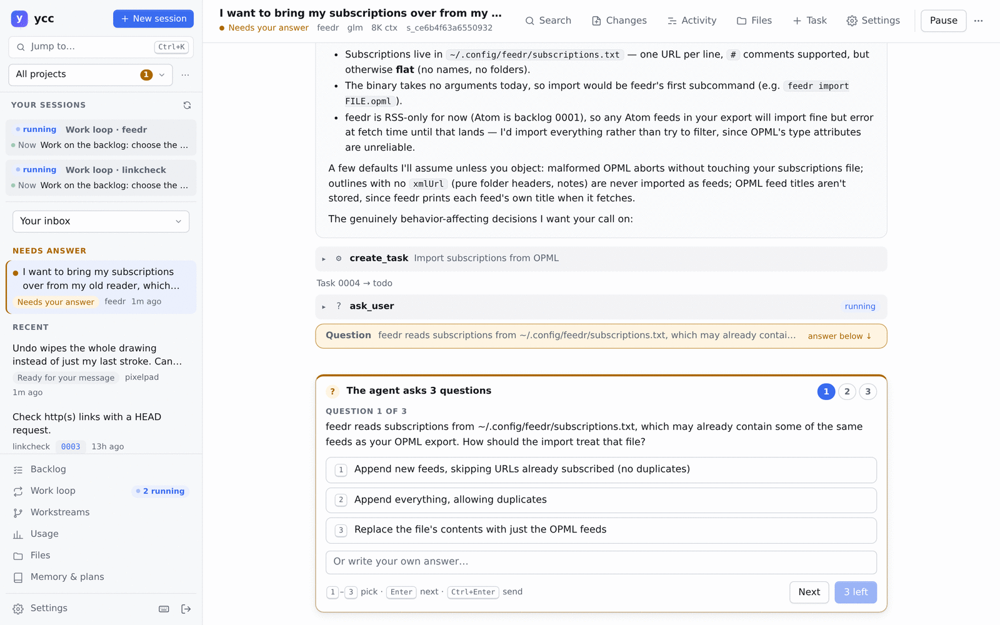
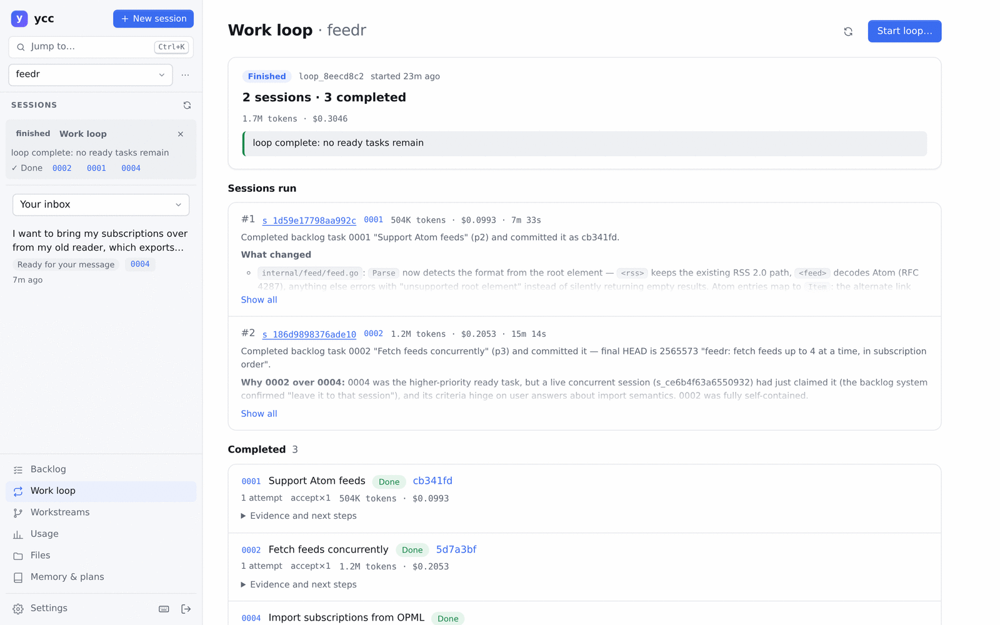

# ycc

**ycc is a docs-driven coding harness.** Each repository keeps a design spec and a backlog,
and ycc's agents turn backlog tasks into reviewed, committed code while keeping those documents
up to date. One long-running daemon on an always-on machine does the work for all of your
projects. You talk to it from a web app at your desk and an iPhone app everywhere else, and
closing either one doesn't stop anything.



- [How I use it](#how-i-use-it)
- [Setting it up this way](#setting-it-up-this-way)
- [How ycc works](#how-ycc-works)
- [Configuration](#configuration)
- [Credentials and secrets](#credentials-and-secrets)
- [Development](#development)

## How I use it

ycc is built around how I work, so this section describes that rather than every option.

**A single daemon runs all my projects.** `ycc daemon --web` runs in a tmux session on a Linux box at home
and only restarts when I deploy a new build. About ten projects are registered with it,
including ycc itself, a game, a storage engine, and assorted side projects. Every session,
work loop, and open question for all of them shows up in one place.

**The phone is where most of it happens.** Most check-ins are on the iOS app: what's running,
what finished, and what's waiting on me. When I notice a bug while using one of my projects, I
open a chat in that project and describe it the way I'd tell a coworker. The agent finds the
cause, fixes it, runs the tests, and I reply "commit it". Questions ("where are we at?", "what's
blocked on me?") work the same way.

**The web app is for longer reading at a desk:** long transcripts and diffs, the backlog,
starting work loops, settings, and usage.

**Chats for small things, the backlog for big things.** A bug or a small feature gets done in
the chat that reported it. Anything bigger becomes backlog tasks. I describe what I want, the
agent asks the questions that change the behavior, and then it writes tasks with acceptance
criteria and updates the spec.

**Work loops do most of the building.** Starting a loop on a project tells the daemon to take
the next ready task, implement it in a fresh session, have a different model review it, commit,
and repeat until nothing is ready. Loops run for hours without me; one busy project landed about
fifty reviewed commits in a day. A task that needs a human decision is marked blocked rather
than guessed at, and I unblock it from the phone.

**Different models for different jobs.** Claude Opus coordinates and writes most of the code,
GPT reviews it, and large or risky changes get reviewed by both. Both run on subscriptions
(`ycc login`) rather than API keys.

**ycc builds ycc.** This repository has its own [`spec.md`](spec.md), [`backlog/`](backlog), and
[`memory.md`](memory.md), and almost all of its recent changes went through the workflow
described here.

### On the phone

These screenshots come from a demo daemon with three small projects. Everything in them,
including the code, the questions, and the commits, was produced by a real model.

<table>
<tr>
<td width="33%" valign="top"><br><b>Everything at a glance.</b> Two loops running, a chat waiting on an answer, and finished work marked unread, across all projects.</td>
<td width="33%" valign="top"><br><b>Report a bug.</b> Start a chat in the project and describe what went wrong.</td>
<td width="33%" valign="top"><br><b>It gets fixed.</b> The agent explains the cause, makes the fix, and adds a regression test.</td>
</tr>
<tr>
<td valign="top"><br><b>"Nice, commit it."</b></td>
<td valign="top"><br><b>Bigger asks start with questions.</b> They open as a sheet; pick an option or type your own.</td>
<td valign="top"><br><b>Read what landed.</b> Every commit in a transcript opens its diff.</td>
</tr>
</table>

### At the desk

<table>
<tr>
<td width="50%" valign="top"><br>The same question on the web, answerable from the keyboard.</td>
<td width="50%" valign="top"><br>A finished work loop. Each task got its own session, review, and commit, and the loop skipped a task that a live chat was already handling.</td>
</tr>
</table>

## Setting it up this way

### 1. Install and log in

```sh
go install github.com/whyrusleeping/ycc/cmd/ycc@latest   # or: go build -o ycc ./cmd/ycc
ycc login anthropic   # Claude Pro/Max; opens a browser login and adds a model to your config
ycc login openai      # ChatGPT Plus/Pro
```

`ycc` is a single binary containing the daemon, the CLI, and the web app. Building it only needs
Go. To use API keys instead of subscriptions, see [Credentials](#credentials-and-secrets). Then
pick which model does what in [`ycc.toml`](#configuration). `ycc doctor` checks the setup and
says how to fix anything it finds.

### 2. Run the daemon somewhere that stays on

```sh
export YCC_TOKEN=$(openssl rand -hex 32)       # every client authenticates with this
ycc daemon --web --addr 100.64.0.1:8787        # e.g. the machine's Tailscale address
```

Run it under tmux, screen, or a service manager so it outlives your shell. The daemon refuses
to listen on a non-loopback address without a token. Treat the token like an SSH key: anyone who
has it can run commands in your projects. Keep the daemon on a private network such as Tailscale
or WireGuard. If a device can't join one, put a TLS-terminating tunnel in front of the daemon
(I use ngrok for the phone) or pass `--tls-cert`/`--tls-key`.

### 3. Add your projects

Each project is a git repository on the daemon's machine. Add them from the web app or the iOS
drawer (**Add project…**), or with `ycc project add ~/code/myproject`. For a new project, start
a **Project manager** session with the **Onboard** preset. In an empty repository it works out
the project's purpose with you, writes an initial `spec.md`, and creates a starter backlog. In
an existing codebase it asks what you want to change next and documents only that part.

### 4. Connect the clients

- **Web:** open `http://<daemon-address>:8787` and paste the token.
- **iOS:** build [`clients/ios`](clients/ios) onto your phone: run `cd clients/ios && xcodegen
  generate`, open `Ycc.xcodeproj` in Xcode, choose your signing team, and run it. Then enter
  the daemon URL and token. The token is kept in the Keychain.

## How ycc works

### The repository is the memory

Agent sessions are disposable, but project state is not. Everything an agent needs to continue
the work lives in plain, committed files that both you and the agents edit:

| File | What it holds |
|------|---------------|
| `spec.md` (+ any `docs/` design set) | How the system is meant to work: behavior, architecture, interfaces, invariants. |
| `backlog/NNNN-*.md` | One Markdown file per task: intent, acceptance criteria, status, dependencies, and a work log. |
| `memory.md` | Short, advisory notes about *working on* the project (gotchas, environment quirks). |
| git history | The record of code changes. ycc works with your git history and doesn't replace it. |

Each session starts with fresh context and rebuilds what it needs from these files. You can
review, edit, or revert any of it with an editor and `git`, and any client or model can pick up
where the last one stopped.

### The spec and the code change together

A contradiction between the spec and the code is a bug. Sessions update the design docs in the
same commit as the code they describe, and `ycc spec-check` flags paths, packages, and symbols
that the docs mention but that no longer exist.

### You decide what gets done; agents decide how

Tasks you create are accepted work (`todo`). Tasks an agent comes up with on its own start as
`proposed`, and they never run until you promote them. Agents record the adjacent work they
discover as proposed follow-ups instead of quietly expanding the task they were given. A task
that needs something only a human can provide is marked `blocked`, with the reason in the task.

### Effort proportional to risk

Tests, docs, and review all have a maintenance cost, so they're used where they help and not by
default. A tiny change gets a self-review, ordinary work gets one reviewer, and large or
hard-to-reverse changes are reviewed by several models in parallel. Reviews judge the change
against the task and real failure modes, not personal taste. [`CONTRIBUTING.md`](CONTRIBUTING.md)
is the written version of this policy.

### Session modes

| Mode | What it's for |
|------|---------------|
| **Chat** | Talking to the coordinator with full file and shell access and no fixed workflow: questions, bug fixes, small features, "commit it". |
| **Work on backlog** | One task from start to finish: read the task and spec, implement, review in proportion to risk, update the task, and commit. Work loops run these back to back. |
| **Project manager** | Planning: discuss design, edit the spec, and create and groom tasks, without writing code. |

While a session runs you can send it a message at any time; it's delivered at the next safe
point. **Interrupt** pauses it at a checkpoint so you can steer, and any finished session
continues when you send it another message.

### The daemon owns the work; clients are just views

The daemon runs the models, edits files, makes commits, and writes an append-only event log for
every session. The web app, the iOS app, and the CLI all subscribe to that log through the same
API, so a client can disconnect, crash, or go to sleep without affecting a session, and you can
start something on one and finish it on another. Sessions you start are *attended*: the agent
can ask you questions. Work loop sessions are *unattended*: they never wait for an answer, and
either make a reversible assumption or mark the task blocked.

The full design is in [`spec.md`](spec.md). The reasoning behind individual decisions is in
[`docs/design/`](docs/design/).

## Configuration

ycc uses the first config file it finds: `./ycc.toml` in the workspace, then
`~/.config/ycc/ycc.toml`, or the one passed with `--config`. `ycc login` adds models to it, and
most settings can be changed from the web or iOS settings screens, which write back to the
file. This is roughly my configuration:

```toml
[models.opus]                      # a logical name you choose
backend = "anthropic"
model   = "claude-opus-5-5"
auth    = "oauth"                  # the `ycc login anthropic` subscription

[models.sol]
backend = "openai"
model   = "gpt-6.1-sol"
auth    = "oauth"                  # the `ycc login openai` subscription

[roles]
coordinator = "opus"               # runs sessions, writes code, commits
implementer = "sol"                # used when the coordinator hands code off to a subagent
reviewers   = ["sol"]

[reviews.tiers.standard]           # one reviewer for ordinary changes
models = ["sol"]

[[reviews.tiers.comprehensive.reviewers]]   # large or risky changes: both models in parallel
model = "opus"
[[reviews.tiers.comprehensive.reviewers]]
model  = "sol"
prompt = "Focus on correctness and code cleanliness."
```

Other backends are `openai-compatible` (any OpenAI-style endpoint, with `base_url` and
`key_env`) and `ollama`. Optional `[budget]` caps (`session_cost`, `loop_cost`) stop sessions and
work loops at a dollar or token limit. [`spec.md` §13](spec.md#13-models-credentials-and-review-tiers)
covers every setting.

If a project's design docs span more than `spec.md`, list them in a committed
`.ycc/config.toml`, and keep the rest of `.ycc/` (session logs and runtime state) out of git
with the ignore rules `.ycc/*` and `!.ycc/config.toml`:

```toml
spec_path = "spec.md"
doc_globs = ["docs/*.md", "docs/design/*.md"]
```

## Credentials and secrets

- **Subscriptions:** `ycc login anthropic|openai`. Tokens stay on the daemon's machine and
  refresh automatically. Anthropic can also be reconnected from the iOS app under
  **Settings → Provider accounts**.
- **API keys:** `ycc token set NAME` stores a key in the machine-local secrets store, and
  configs refer to it only by name (`key_env = "NAME"`). Keys are never passed to tool processes,
  and agent shells start with known credential variables removed. That is a safety net, not a
  sandbox: a shell running as your user can still read your files.
- **Web search:** the `web_search`/`fetch_page` tools use [Exa](https://exa.ai) with
  `EXA_API_KEY`.

**Never paste a credential into a prompt or an answer to an agent's question.** Session logs
are durable model history. ycc refuses input that is obviously credential-shaped, but it can't
catch everything. If a secret ends up in a session, rotate it at the provider first.

## Development

ycc is developed with ycc, and this repository uses the layout it asks of other projects:
[`spec.md`](spec.md), [`backlog/`](backlog), [`plans/`](plans), [`memory.md`](memory.md), and
[`CONTRIBUTING.md`](CONTRIBUTING.md).

| Path | Contents |
|------|----------|
| `cmd/ycc` | the binary: CLI commands, daemon startup |
| `internal/` | engine (agent loop), orchestrator (modes, work and review flow), server (Connect RPC), session/event log, tools, providers, workstreams, embedded web bundle |
| `proto/ycc/v1` | `ycc.proto`, the wire schema shared by every client |
| `clients/web` | the web app (TypeScript, React, Vite); the bundle is committed to `internal/web/dist` |
| `clients/ios` | the iPhone app (SwiftUI shell + `YccKit` Swift package) |

The CLI (`ycc start`, `ycc list`, `ycc task …`, `ycc export`, and more) is documented in
[`docs/cli.md`](docs/cli.md), and [`docs/remote-api.md`](docs/remote-api.md) documents the API
for writing other clients.

CI runs Go 1.26.10 on Linux and Xcode 16.4 on macOS. Before submitting a change, run the
matching local checks. The Swift checks require macOS, and none of the checks need provider
API keys.

```sh
# Go: formatting, vet, tests (uncached), end-to-end tests, race detector, docs drift
test -z "$(git ls-files '*.go' | xargs gofmt -l)"
go vet ./...
go test -count=1 ./...
go test -count=1 -v ./internal/e2e   # every TestE2E test must PASS, not SKIP
go test -race -count=1 ./...
go run ./cmd/ycc spec-check

# Vulnerability scan (the result depends on the Go patch version)
go install golang.org/x/vuln/cmd/govulncheck@v1.8.0 && govulncheck ./...

# Web client: install from the lockfile, typecheck, bundle, and run Vitest; the committed bundle must match
scripts/web-build.sh
git diff --exit-code -- internal/web/dist

# iOS (macOS only, XcodeGen 2.44.1)
swift test --package-path clients/ios/YccKit
(cd clients/ios && xcodegen generate)
xcodebuild -project clients/ios/Ycc.xcodeproj -scheme Ycc \
  -destination 'generic/platform=iOS Simulator' CODE_SIGNING_ALLOWED=NO build
```

If you change `proto/ycc/v1/ycc.proto`, regenerate the Go, Swift, and TypeScript bindings and
commit them together, following [`plans/build-and-test.md`](plans/build-and-test.md). CI checks
the result with pinned tool versions: buf v1.71.0, protoc-gen-go v1.36.11, and
protoc-gen-connect-go v1.20.0.
